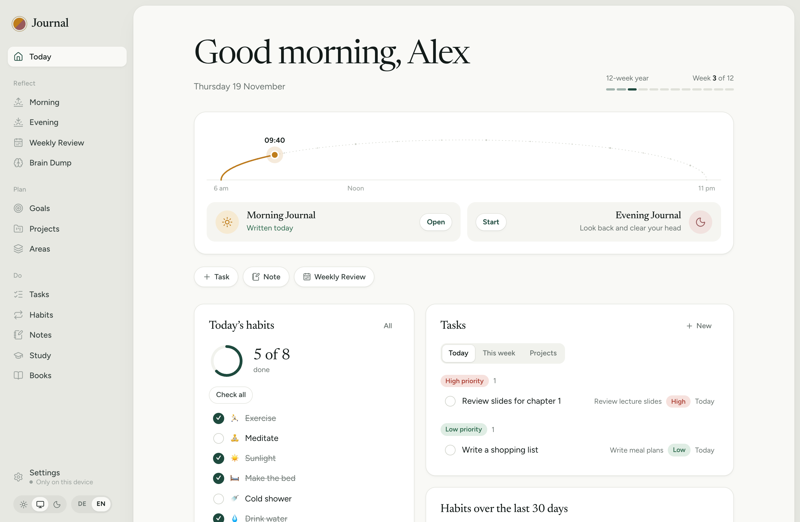
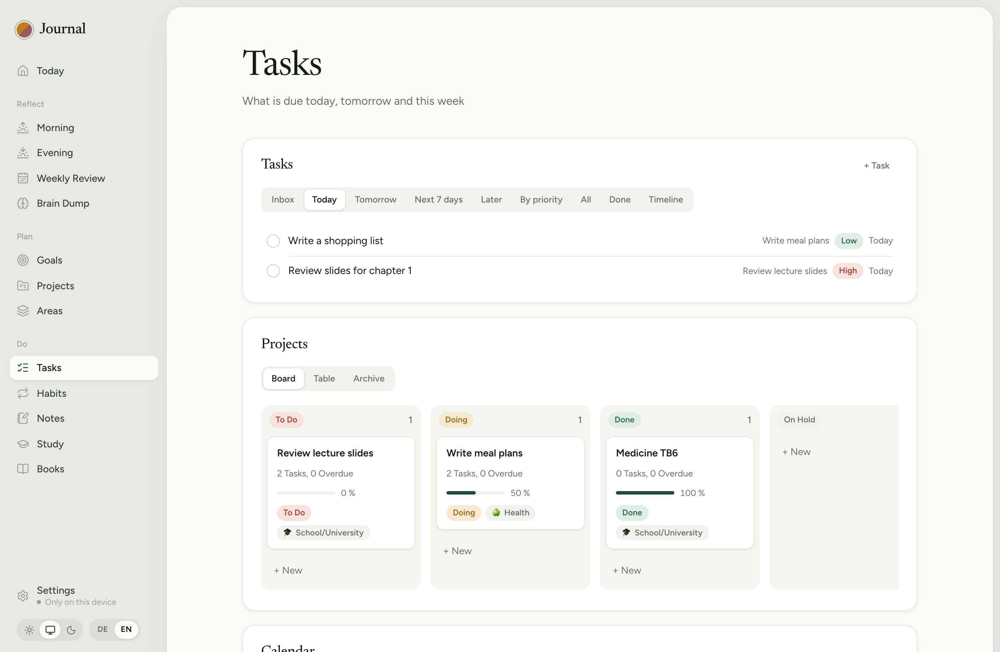

# 12 Week Mastery

A journal and productivity web app: morning and evening journals, tasks, projects, habits, notes and goals for a 12-week year.

**Live:** [journal.berger-labs.com](https://journal.berger-labs.com). No account needed; your data stays in your browser until you register to sync.

[](https://github.com/Simons-Github/Journal/actions/workflows/ci.yml)
[](LICENSE)

<picture>
  <source media="(prefers-color-scheme: dark)" srcset="docs/screenshots/today-dark.png">
  
</picture>

## Why

The app started as a rebuild of the Notion template "12 Week Mastery". It keeps daily reflection and planning in one place: the day starts with a morning journal and ends with an evening journal, and the habits, tasks and projects in between feed into the goals for the 12-week year.
<!-- TODO(Simon): add 1-2 sentences on why you built this -->

## Features

- Morning, evening and weekly journals with habits, brain dump, gratitude and a wind-down checklist.
- 12-week year: goals by life area, projects by goal, progress calculated from tasks.
- Tasks as inbox, today, next 7 days, by priority, timeline and a drag-and-drop calendar.
- Habit tracker with streaks, a 30-day chart and a weekly grid.
- Notes, study notes with review dates, and books with shelf and ratings.
- Optional AI assistant and course import that run on your own API key. Interface in English or German.

<p>
  
  
</p>

## Tech stack

| Tool | Role |
| --- | --- |
| React 18, TypeScript, React Router, Vite | Frontend |
| Hand-written CSS with light and dark tokens, Lucide icons | Styling |
| Express, as one Vercel Function under `/api` | API; one deployment for app and API |
| PostgreSQL (Neon on Vercel, `prisma dev` locally), Prisma | Storage |
| JWT in an httpOnly cookie, bcrypt, Zod | Auth and validation |
| Anthropic SDK; optional Gemini and YouTube Data API | Assistant and course import |
| GitHub Actions (Node 22), Vercel | CI and hosting |

## Design decisions

**Local-first, with versioned saves.** Every change is written to `localStorage` at once, so the app works offline and without an account. With an account, the workspace is uploaded about a second later together with the version it is based on. If another device saved in between, the API answers `409` and the app asks which version to keep. The trade-off: conflicts are resolved for the whole workspace, not per entry.

**One JSON document per user.** The workspace is a single JSON document (max. 4 MB) instead of relational tables for tasks, notes and habits. That keeps sync, export and import simple and avoids migrating a schema for every UI change. The cost is that the server cannot query inside the data, and large workspaces hit the size limit.

**Backups instead of history.** The server keeps the last 50 versions per user. It snapshots before imports, resets, restores and conflicts, and otherwise at most every 10 minutes, so a bad sync or import can be rolled back.

**Bring your own AI key.** Users add their own API keys, stored encrypted with AES-256-GCM and never returned to the browser. The assistant can read course pages from links you paste; the server only fetches public https hosts and checks the resolved address on every connection, including redirects, to block private and local targets (SSRF). Failed sign-ins are limited to 10 per 15 minutes per email.

## Architecture

```
Browser (React)
  ├── localStorage            the whole workspace as one JSON document
  └── fetch /api/*            Vercel Function (Express)
                                ├── /api/auth       register, login, logout, me, password, account
                                ├── /api/workspace  load, save (versioned), backups, restore
                                ├── /api/ai         assistant, course import, API keys
                                └── Prisma          Postgres (Neon)
```

## Running locally

Requires Node.js 20 or newer and npm.

```bash
npm install
cp .env.example .env          # set JWT_SECRET: openssl rand -hex 32
npm run db:start              # local Postgres via `prisma dev`
npx prisma migrate dev        # create the tables
npm run dev                   # app: http://localhost:5180, API: http://localhost:3001/api
```

More in [docs/development.md](docs/development.md) (environment variables, scripts, troubleshooting, database, privacy details) and [docs/deployment.md](docs/deployment.md).

## Testing

`npm test` runs the [Vitest](https://vitest.dev) suite. It covers the date helpers and progress calculations, the workspace sync rules (409 on a stale version, the 4 MB limit, automatic backups) through the real Express app with an in-memory Prisma stand-in, the SSRF checks of the course-page fetcher, and the AES-256-GCM encryption of stored API keys. No database or network is needed.

CI runs the tests and then `npm run build`, which type-checks the app and the server and builds the frontend.

## Limitations

- One document per user, 4 MB at most; conflicts are resolved for the whole workspace.
- No password reset by email, because the app sends no emails. Keep a JSON export if you rely on your data.
- Switching the language translates the interface, not your entries.
- Not an installable app (PWA); on phones it runs in the browser.
- The AI assistant works only for signed-in users with their own API key.

## License

MIT, see [LICENSE](LICENSE). Screenshots show sample data.
