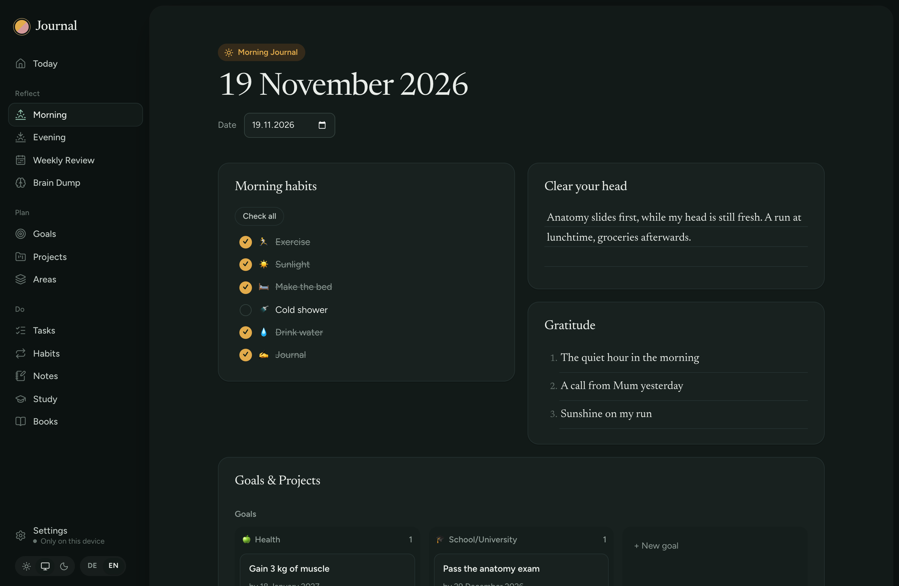
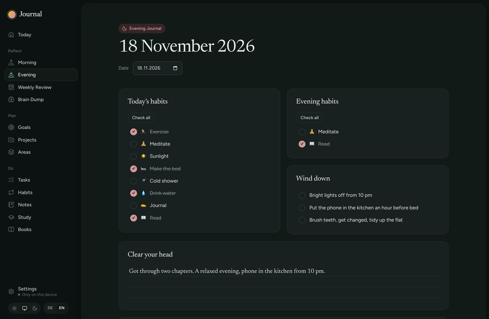
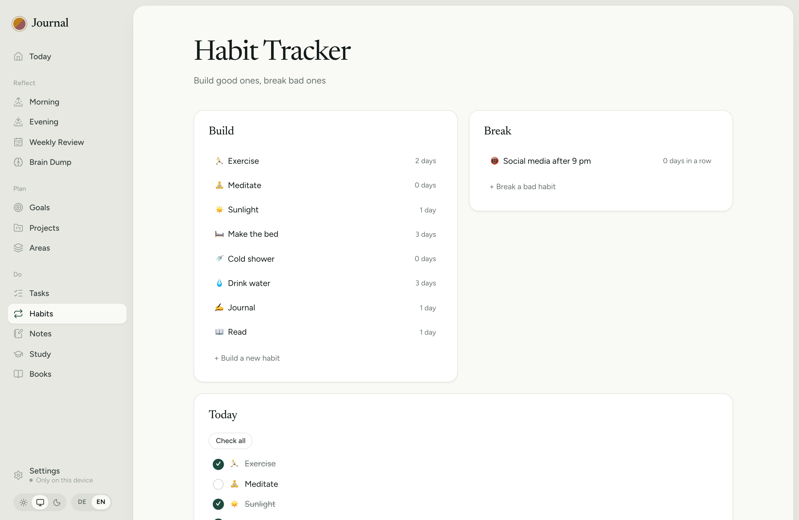
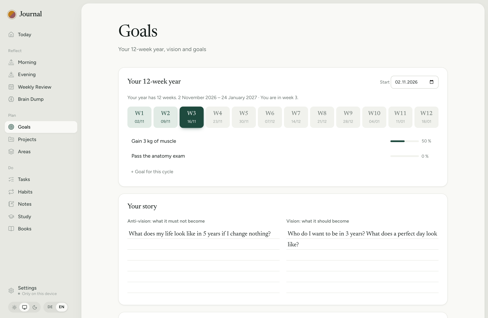
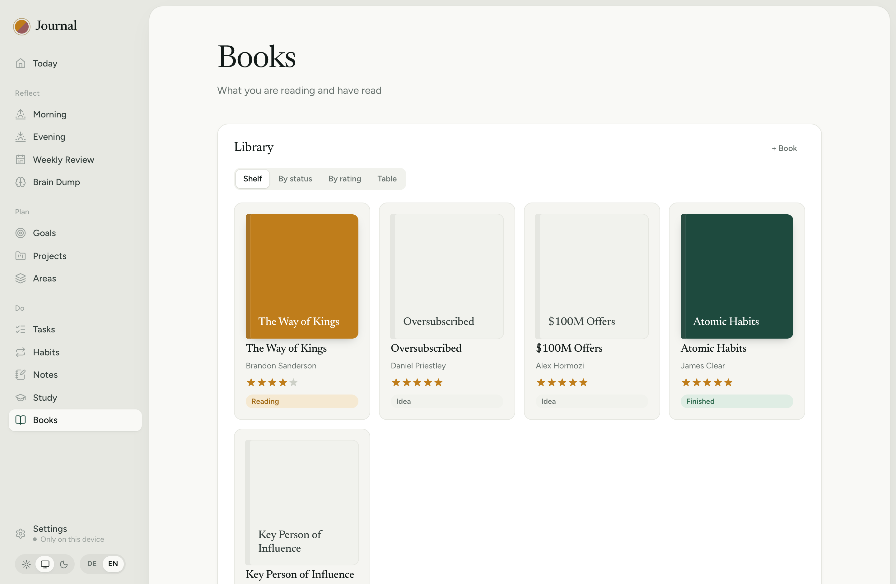
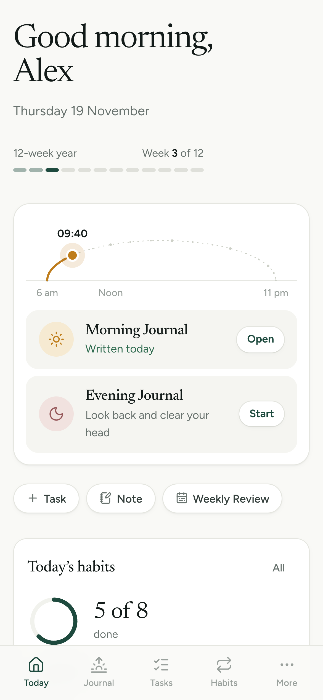
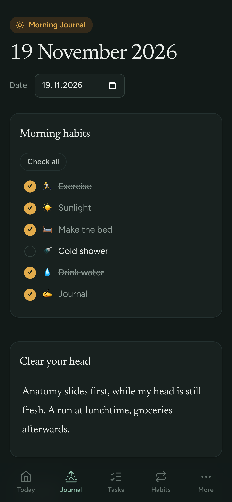

<div align="center">

# Journal

**Morning and evening journaling, habits, goals in a 12-week year, tasks, notes and study – in one calm app.**

<p>
  <a href="https://github.com/Simons-Github/Journal/actions/workflows/ci.yml"></a>
  
  
  
  <a href="./LICENSE"></a>
</p>

**Live:** [journal.berger-labs.com](https://journal.berger-labs.com) – try it without an account; your data stays in your browser until you register.<br>
**Repository:** [github.com/Simons-Github/Journal](https://github.com/Simons-Github/Journal)

<br>

<picture>
  <source media="(prefers-color-scheme: dark)" srcset="docs/screenshots/today-dark.png">
  
</picture>

</div>

## Contents

- [About](#about)
- [Screenshots](#screenshots)
- [Tech stack](#tech-stack)
- [Architecture](#architecture)
- [Run locally](#run-locally)
- [Database](#database)
- [CI](#ci)
- [Project structure](#project-structure)
- [Deployment](#deployment)
- [Limits & privacy](#limits--privacy)
- [License & author](#license--author)

## About

Journal brings daily reflection and planning into one place. The day starts with the **Morning Journal** and ends with the **Evening Journal**. In between are habits, tasks and projects that feed into your goals for the **12-week year**. The app started out as a rebuild of the Notion template “12 Week Mastery”.

### Highlights

- **Works without an account** – everything is stored in the browser; register only when you want to sync.
- **Sync across devices** with version numbers, a conflict banner and server-side backups of the last 50 states.
- **Morning, evening and weekly journals** with habits, brain dump, gratitude and a wind-down checklist.
- **12-week year** – goals by life area, projects by goal, progress calculated from tasks.
- **Tasks** as inbox, today, next 7 days, by priority, timeline and a drag-and-drop calendar.
- **Habit tracker** with streaks, a 30-day chart and a weekly grid.
- **Notes and study notes** with spaced-repetition review dates; books with shelf and ratings.
- **English or German**, light or dark – chosen per device in the sidebar or under *Settings*.
- **Mobile layout** with a bottom tab bar.
- **JSON export/import**, password change and account deletion.

## Screenshots

|  |  |
| :---: | :---: |
|  |  |
| **Morning Journal** – habits, clearing your head, gratitude | **Evening Journal** – wind-down routine, shown in dark mode |
|  |  |
| **Tasks** – inbox, today, 7 days, priority, timeline, calendar | **Habit Tracker** – build and break habits, streaks |
|  |  |
| **Goals** – 12-week year, vision and goals by area | **Books** – shelf, status, ratings |

<p align="center">
  
  &nbsp;&nbsp;
  
  <br>
  <sub>On phones the sidebar becomes a tab bar; “More” opens the full navigation.</sub>
</p>

## Tech stack

| Area | Technology |
| --- | --- |
| Frontend | React 18, TypeScript, React Router, Vite |
| Styling | Hand-written CSS with design tokens for light and dark mode, Lucide icons |
| Fonts | Figtree (interface), Newsreader (headings and writing), self-hosted via Fontsource |
| Backend | Express as a single Vercel Function under `/api` |
| Database | PostgreSQL (Neon on Vercel, `prisma dev` locally) via Prisma |
| Auth | JWT in an httpOnly cookie, bcrypt, Zod validation, rate limiting |
| Languages | English and German in [`src/i18n.tsx`](src/i18n.tsx) |
| CI | GitHub Actions (Node 22) |
| Hosting | Vercel |

## Architecture

```
Browser (React)
  ├── localStorage            →  the whole workspace as one JSON document (works offline)
  └── fetch /api/*            →  Vercel Function (Express)
                                    ├── /api/auth       register, login, logout, me, password, account
                                    ├── /api/workspace  load, save (versioned), backups, restore
                                    └── Prisma          →  Postgres (Neon)
```

The app is **local-first**: every change is written to `localStorage` immediately. With an account, the workspace is uploaded as one JSON document about a second later. Each save carries the version it is based on; if the server has a newer version from another device, the API answers `409` and the app asks which version to keep. Before imports, resets, restores and conflicts – and otherwise at most every 10 minutes – the server stores a backup.

Security: passwords are hashed with bcrypt, the session is a JWT in an httpOnly cookie, failed sign-ins are limited to 10 per 15 minutes, and write requests must be JSON (which forces a CORS preflight from other sites). Vercel adds HSTS, `X-Frame-Options` and related headers.

## Run locally

**Requirements:** Node.js 20 or newer (CI uses 22), npm.

```bash
git clone https://github.com/Simons-Github/Journal.git && cd Journal
npm install
cp .env.example .env          # set JWT_SECRET: openssl rand -hex 32
npm run db:start              # local Postgres via `prisma dev` (no Docker needed)
npx prisma migrate dev        # create the tables
npm run dev                   # app: http://localhost:5180 · API: http://localhost:3001/api
```

`.env` (see [`.env.example`](.env.example)):

```env
DATABASE_URL="postgres://…"           # pooled connection used by the API
DATABASE_URL_UNPOOLED="postgres://…"  # direct connection used for migrations
JWT_SECRET=""                         # at least 32 characters
```

The app works without the API too – it then simply stays local.

### Scripts

| Command | What it does |
| --- | --- |
| `npm run dev` | Starts the frontend (Vite) and the API together |
| `npm run db:start` | Starts the local Postgres |
| `npm run db:migrate` | Creates a new migration and applies it |
| `npm run build` | Type-checks app and server, then builds for production |
| `npm run preview` | Serves the production build locally |

### Troubleshooting

| Symptom | Typical cause |
| --- | --- |
| API answers “Server nicht konfiguriert: JWT_SECRET …” | `JWT_SECRET` is missing or shorter than 32 characters |
| `prepared statement already exists` locally | The local URL needs `pgbouncer=true&connection_limit=1`, as in `.env.example` |
| Sync shows “Server unreachable” | The API is not running – start everything with `npm run dev` |
| Vercel build fails at `prisma migrate deploy` | `DATABASE_URL_UNPOOLED` is missing in the Vercel project |
| Saving fails with “Workspace is too large” | The workspace is over 4 MB – export it and archive old entries |

## Database

| Table | Purpose |
| --- | --- |
| `users` | Email and bcrypt password hash |
| `workspaces` | The current workspace per user as one JSON document, with a version number |
| `workspace_versions` | Backups of earlier states, with the reason they were made |
| `auth_attempts` | Failed sign-in and sign-up attempts for rate limiting |
| `ai_usage` | Tokens and cost per AI assistant request, for the daily limit |
| `user_api_keys` | Each user's own AI API keys, encrypted (AES-256-GCM) |

Deleting an account removes its workspace, all backups, its AI usage records and its API keys (cascade). Schema: [`prisma/schema.prisma`](prisma/schema.prisma).

## CI

On every push and pull request to `main`, [GitHub Actions](.github/workflows/ci.yml) runs on Node 22:

`npm ci` → `npm run build` (type-check of app and server, then the production build)

## Project structure

```
src/
├── pages/            # Today, journals, goals, projects, areas, tasks, habits, notes, study, books, settings
├── components/       # Editor dialogs, boards, task list, calendars, habit chart, shared UI
├── store.tsx         # Workspace state, sample data, derived values
├── sync.tsx          # Sign-in, upload, conflicts, backups
├── i18n.tsx          # English translations (German text is the key)
└── styles.css        # Design tokens and all styles
server/               # Express API: auth, workspace, error handling
api/index.ts          # Vercel Function entry point
prisma/               # Schema and migrations
docs/screenshots/     # Images used in this README
```

## Deployment

The app runs on Vercel at [journal.berger-labs.com](https://journal.berger-labs.com). App and API share **one** Vercel project: the frontend as a static site, the API as a Function under `/api`. Every push to `main` deploys automatically.

1. **Import the repository** on vercel.com → *Add New → Project*. Leave *Root Directory* empty; framework, build command and output come from [`vercel.json`](vercel.json).
2. **Connect a database:** *Storage → Create Database → Neon (Postgres)*. This sets `DATABASE_URL` and `DATABASE_URL_UNPOOLED`.
3. **Set the secret:** *Settings → Environment Variables* → `JWT_SECRET` = output of `openssl rand -hex 32`.
4. **Deploy.** The build runs `prisma migrate deploy` and creates the tables.

Alternatively via the CLI: `vercel link`, `vercel env add JWT_SECRET`, `vercel --prod`.

### Production checklist

- [ ] `DATABASE_URL` and `DATABASE_URL_UNPOOLED` point to the same Neon database
- [ ] `JWT_SECRET` set for Production **and** Preview (at least 32 characters; changing it signs everyone out)
- [ ] Custom domain added under *Settings → Domains*
- [ ] `/api/health` answers `{"ok":true}`
- [ ] AI features need no server key: every user adds their own API keys under *Settings → AI assistant* and pays for their own usage. Optional: `AI_KEYS_SECRET` (encrypts the stored keys; otherwise derived from `JWT_SECRET` – changing it makes stored keys unreadable), `AI_SERVER_KEY_EMAILS` plus `ANTHROPIC_API_KEY` / `GEMINI_API_KEY` / `YOUTUBE_API_KEY` to let only these addresses use server keys, `AI_DAILY_BUDGET_USD` for the default daily limit
- [ ] Registering and signing in work on the live domain

## Limits & privacy

- The workspace is stored as **one document** per user (max. 4 MB). Conflicts are resolved for the whole workspace, not per entry.
- There is **no password reset by email** – the app sends no emails. Keep a JSON export if you rely on your data.
- Switching the language translates the interface, **not your entries**.
- No installable app (PWA); on phones it runs in the browser.
- There are no automated tests yet; CI checks types and the build.
- Your data lives in your browser and, if you register, in the Postgres database of this deployment.
- **AI features use each user's own API keys** (Anthropic; optionally Gemini and YouTube). Keys are stored encrypted, verified when saved and never sent back to the browser – only their last four characters are shown. Each user sets their own daily cost limit.
- The **AI assistant** (signed-in users only) sends what it looks up – notes, books, brain dump pages, tasks, projects and goals – plus your chat messages to Anthropic's Claude API. Journal entries and habits are never sent. Suggested tasks are only saved when you accept them.
- The **course import** reads PDFs in your browser and sends only the extracted text to the Claude API; the file itself is not uploaded. Dates are planned by the app, and entries the AI could not quote from the material are flagged for review. Course links are fetched by the server (public https pages only; private and local addresses are blocked). YouTube playlists are read through the YouTube Data API; for a single video only its URL is sent to Google's Gemini API, which watches the public video. Chat and import share the user's daily cost limit (default $1). *Settings* has **JSON export** and **delete account**.

Issues and pull requests are welcome. Please do not commit secrets or `.env` files.

## License & author

MIT © 2026 **[Simon Berger](https://github.com/Simons-Github)** – see [LICENSE](LICENSE).

<sub>Screenshots show sample data.</sub>
