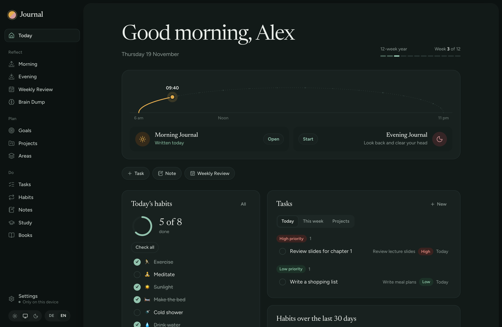

# 12 Week Mastery

[](https://github.com/Simons-Github/Journal/actions/workflows/ci.yml) [](LICENSE)

A journal and planner built around the "12-week year": morning and evening journals, tasks, projects, habits, notes and goals in one app.

**Live demo:** [journal.berger-labs.com](https://journal.berger-labs.com). No account needed. Your data stays in the browser until you register to sync it.



## Features

- Morning, evening and weekly journals with habits, gratitude and a brain dump
- Goals per life area, projects per goal, progress calculated from tasks
- Tasks with inbox, today, next 7 days, priorities and a drag-and-drop calendar
- Habit tracker with streaks and a 30-day chart
- Notes, study notes with review dates and a book list
- Optional [AI assistant and course import](#ai-features) with your own API key
- English and German interface

<p>
  
  
</p>

## AI features

Both features are optional. They need an account and your own Anthropic API key, which you add in the settings.

**Assistant.** A chat panel that knows your workspace:

- Searches your notes, study notes, books and brain dump and names the notes an answer comes from
- Looks up tasks, projects and goals
- Reads a website, such as a course page, when you paste its link into the chat
- Suggests tasks with due dates and priorities, grouped into a project if it fits

It can't change or delete anything. Suggested tasks appear as a card that you can edit, and they are saved only when you accept them. It doesn't see your journal entries or habits.

**Course import.** Turns course material into a project with dated tasks:

- Sources: PDF, text file, pasted text or a course page link. YouTube playlists need a YouTube Data API key, single videos a Google Gemini key (up to 2 hours per run).
- The model only extracts the structure and estimates the effort. The app plans the dates, either following the course weeks or by your hours per week, so changing the plan costs no further AI call.
- For text sources, each entry is checked against a quote from the material and flagged if the quote isn't found. Video entries link to a timestamp instead.
- Nothing is saved until you have reviewed the plan. You can also create an overview note with it.

By default the chat uses Claude Haiku 5.5, the course import Claude Sonnet 5.5 and the video import Gemini 3.5 Flash-Lite. A daily cost limit per user (1 USD unless changed) protects your API account. What is sent to the providers is listed under [privacy details](docs/development.md#privacy-details).

## Tech stack

| | |
| --- | --- |
| Frontend | React 18, TypeScript, React Router, Vite, plain CSS with light and dark themes |
| Backend | Express, deployed as a single Vercel Function under `/api` |
| Database | PostgreSQL (Neon), Prisma 7 |
| Auth | JWT in an httpOnly cookie, bcrypt, Zod for input validation |
| AI | Anthropic SDK, optionally Gemini and the YouTube Data API for course import |
| Tooling | Vitest, GitHub Actions, Vercel |

## How it works

```
Browser (React)
  ├── localStorage      the whole workspace as one JSON document
  └── /api/*            Express on Vercel
        ├── /auth       register, login, logout, account
        ├── /workspace  load, versioned save, backups, restore
        ├── /ai         assistant, course import, API keys
        └── Prisma  ->  Postgres
```

Every change is written to `localStorage` right away, so the app works offline and without an account. With an account, the workspace is uploaded about a second later together with the version it was based on. If another device saved in the meantime, the server answers with `409` and the app asks which version to keep.

I store the workspace as one JSON document per user (up to 4 MB) instead of separate tables for tasks, notes and habits. That keeps sync, export and import simple, and I don't need a migration for every UI change. The downside is that the server can't query inside the data, and conflicts are resolved for the whole workspace, not per entry. To make mistakes recoverable, the server keeps the last 50 versions and takes a snapshot before imports, restores and conflicts.

The AI features use the user's own API key. Keys are encrypted with AES-256-GCM and never sent back to the browser. When the assistant reads a course page from a pasted link, the server only connects to public addresses and checks every redirect, so it can't be used to reach internal services (SSRF).

## Running locally

You need Node.js 22.12 or newer.

```sh
npm install
cp .env.example .env     # set JWT_SECRET, e.g. openssl rand -hex 32
npm run db:start         # local Postgres via prisma dev
npx prisma migrate dev
npm run dev              # app on :5180, API on :3001
```

Environment variables, scripts and troubleshooting are in [docs/development.md](docs/development.md), deployment in [docs/deployment.md](docs/deployment.md).

## Tests

`npm test` runs the Vitest suite without a database or network. It covers the date helpers and progress math, the sync rules (409 on stale versions, the size limit, backups) against the real Express app with an in-memory Prisma stand-in, the SSRF checks and the key encryption. CI runs the tests and the production build.

## Limitations

- No password reset by email, since the app doesn't send emails.
- Switching the language translates the interface, not your entries.
- Not installable as a PWA. On phones it runs in the browser.

## License

MIT. Screenshots show sample data.
